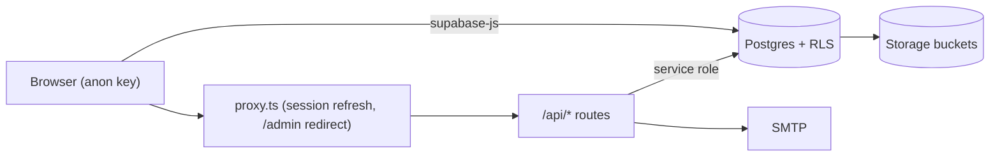

# Audit report: challan-system (22 Oct 2026)

**Scope:** the whole repository. That covers the Next.js 16 App Router app (single package, not a monorepo), 25 client-side Supabase services, 6 API routes, 35 SQL migrations, the auth and permission contexts, and the configuration.
**Baseline:** working tree clean on `main` at `e6db7ec`. Nothing was committed, pushed or deployed. No database was touched.

Most data access goes straight from the browser to Supabase. That makes **RLS the real security boundary**. The UI permission matrix decides what is shown; it does not stop anyone.

---

## A. Overall health

| Area | Assessment |
|---|---|
| Architecture | Practical and readable: services → components, with types in `types/`. The weak points are large client components (1,000–2,300 lines) and multi-step writes done from the browser without transactions. |
| Code quality | TypeScript is in strict mode and typechecks cleanly. There are 105 unused-variable warnings, plus 15 errors from the `set-state-in-effect` lint rule (an existing pattern). |
| Security | **Weak before this audit.** There was a hardcoded admin password and HMAC secret, an open redirect, data readable across tenants and across employees through RLS, and a way for staff to make themselves owner. Most of this is fixed in code or in the new migration. That migration **still has to be applied**. |
| Performance | Fine at the current scale. Reports and the year-end report fetch whole tables and stop at Supabase's 1,000-row cap (`max_rows`), so totals will be wrong once a company has more than 1,000 invoices. |
| Tests / build | There were only 2 test files and no CI workflow in the repo. Now 27 tests pass, the typecheck passes and the production build passes. |

---

## B. Findings and status

**Fixed** means changed in this diff. **Migration** means the fix is in `supabase/migrations/20261022000001_security_hardening.sql`, which has not been applied yet.

### Critical

| # | Finding | Where | Status |
|---|---|---|---|
| C1 | **Hardcoded landing-admin password and HMAC secret** were used as fallbacks and are in git history since 21 Sep. If the env vars were missing, anyone could log in or forge an admin session. | `lib/landing-admin/auth.ts` | Fixed (now refuses login when not configured). **Rotate the password and the secret.** |
| C2 | **Next.js 16.2.10** is affected by several critical advisories: RCE through AVIF image optimisation (the landing page serves `.avif`), RCE on Windows hosts, a proxy/middleware bypass, and SSRF. | `package.json` | Fixed: bumped to 16.4.2, with build, typecheck and tests verified. **Run `npm install` on Windows.** |
| C3 | **Purchase payments were counted twice.** The bill header stored `paid_amount`, and `addPurchasePayment` then added the same amount again. | `services/purchases.service.ts` | Fixed |
| C4 | **Any staff member could make themselves owner.** The companies UPDATE policy allowed any member to change `user_id`, and the employees API then treated that user as owner. The API could then reset colleagues' passwords and read their bank and PAN details. | RLS + `lib/employees-api.ts` | API fixed; RLS in the migration |

### High

| # | Finding | Where | Status |
|---|---|---|---|
| H1 | **Every self-registered user could read, edit and delete all website inquiries** (names, emails, phones). | `inquiries` RLS | Migration (adds a `platform_admins` table; one manual seed step) |
| H2 | **Any staff member could read every colleague's bank account, IFSC, PAN, UAN and PF numbers.** | `company_members` RLS | Migration |
| H3 | **An Admin could still promote themselves to Owner.** The migration that was meant to remove the old Admin policy dropped a policy with a different name. | `company_members` RLS | Migration |
| H4 | **Salary slips ignored the permission matrix.** Any member could read or change any salary slip. | `salary_slips` RLS | Migration |
| H5 | **Open redirect after login or password reset** through `/auth/callback?next=//evil.com`. | `app/auth/callback/route.ts` | Fixed |
| H6 | **Vault documents (bills and receipts) were linked through public URLs.** | `documents.service.ts` | Fixed: signed URLs valid for 10 minutes. The migration makes the bucket private. |
| H7 | **Staff with view-only access could open `/new` and `/edit` pages and save.** | `PermissionContext.tsx` | Fixed in the UI. DB-level enforcement is still to do (E1). |
| H8 | **Permissions loaded for one company could apply to another.** The gate rendered pages before permissions had loaded, and a slow response could overwrite a newer one. | `PermissionContext.tsx` | Fixed |
| H9 | **Purchase stock errors were swallowed.** `.rpc()` returns `{error}` instead of throwing. The bill was saved while stock was not updated, and deleting a Draft removed stock it had never added. | `purchases.service.ts` | Fixed (errors now surface, with compensation and rollback) |
| H10 | **Switching company flipped `companies.is_active` for every member's company** through an unscoped bulk UPDATE. | `companies.service.ts` | Fixed (selection now lives in localStorage) |
| H11 | **Blank taka rows counted as pieces and were deducted from stock.** | delivery-challan form and service | Fixed |
| H12 | **The Overdue / Pending filter used the stored status**, which never changes to Overdue by itself. | `challans.service.ts` | Fixed |
| H13 | **Invoices could be left half-written.** Creating one could leave an orphan header; editing one deleted its items before reinserting them. | `challans.service.ts` | Fixed (compensating steps) |
| H14 | **One load error left the whole app on a spinner forever.** | `AuthContext.tsx` | Fixed |
| H15 | **The contact form sent user-controlled HTML through company SMTP** to any address, with no rate limit. | `lib/email.ts`, `/api/contact` | Fixed (escaping, length caps, 5 requests per 10 minutes per IP) |
| H16 | **Admin login had no rate limit.** | `/api/admin/landing/login` | Fixed (in-memory and best effort; see E4) |
| H17 | **Users could reset passwords of people in other tenants.** An owner could reset the password of an employee who also uses that account in another company. | `/api/employees` PATCH | Fixed |

### Medium

- **Searches broke on special characters.** A search containing `,` `(` `)` `.` `:` broke every `.or()` search (HTTP 400) and could inject extra filter clauses. **Fixed** in 14 services through `orIlikeValue()`.
- **Dates were taken in UTC.** Using `toISOString().slice(0,10)` gave yesterday's date in IST before 05:30. That affected default dates, "today" counts, the start of the month, and the last day of the month in personal expenses. **Fixed** with `lib/dates.ts`.
- **Amounts in words were wrong.** ₹1051.05 became "… undefined Only", and amounts of ₹100 crore or more broke. **Fixed** (paise are now supported, crore is handled recursively).
- **Duplicated invoices kept the old due date.** **Fixed**: the due date is recomputed.
- **Year-end taxable sales ignored discount.** Cancelled invoices were also counted in the dashboard and reports. **Fixed** (consistent with the year-end report).
- **Saving settings wiped `delivery_challan_terms`.** **Fixed.**
- **The purchase form had problems.** It started with a "Yarn 100 Kg @ ₹240" sample line, switching between GST and non-GST didn't recalculate lines, and the paid amount had no limits. **Fixed.**
- **Invoice line amount went stale** when the quantity or rate was cleared. **Fixed.**
- **Invoice and delivery challan lists showed stale results** when responses arrived out of order. **Fixed.** The same issue remains in 6 other lists (E6).
- **JSON-LD did not escape `</script>`.** **Fixed.** Legal-page HTML is still rendered without sanitising; only the admin can write it (E7).
- **Uploads were checked on MIME type OR extension.** Now both must pass, and an old file can only be deleted under `images/`. **Fixed.**
- **Some RPCs were callable without a login.** `generate_personal_expense_number` skipped its check for anonymous callers (`NULL <> x`). `check_company_has_data` had no check at all. SECURITY DEFINER functions were executable by `anon` through PUBLIC. **Migration.**

### Low

- **`.env.example` was wrong.** It listed variables the code never reads (GST, WhatsApp, MASTER_*) and missed the ones it needs. It was also git-ignored. **Fixed and un-ignored.**
- **`.env.local.example` (untracked) contains a real service-role key.** It is not in git history (I checked), but it shouldn't sit in an "example" file. **Not changed** (it may be your only copy). Move the values into `.env.local` and blank this file.
- **The README is the create-next-app boilerplate.** Not changed.

---

## C. Changes implemented (56 files plus 6 new)

- **Security:** `lib/landing-admin/auth.ts`, `app/api/admin/landing/{login,content,upload}`, `app/api/contact`, `app/api/employees`, `lib/employees-api.ts`, `app/auth/callback`, `app/page.tsx`. New files: `lib/security/{safe-redirect,rate-limit,html}.ts`.
- **Database:** new migration `20261022000001_security_hardening.sql`.
- **Permissions:** `context/PermissionContext.tsx`, `constants/permissions.ts` (`actionFromPathname`), `context/AuthContext.tsx`.
- **Business logic:** `services/{purchases,challans,delivery-challans,companies,documents,financial-years,dashboard,reports,expenses,personal-expenses,...}.ts`, `lib/number-to-words.ts`, `lib/challan-item.ts`, `lib/table/{pagination,search-helpers}.ts`. New file: `lib/dates.ts`.
- **UI:** the purchase form, document preview, vault and detail dialog; the challan form and list; the delivery-challan form and list; `company-provider`; date defaults in 10 forms.
- **Tooling:** `package.json` (Next 16.4.2, `typecheck` script, new tests in `test`), `package-lock.json`, `.env.example`, `.gitignore`. New files: `tests/security.test.ts`, `tests/business-logic.test.ts`.

---

## D. Validation (actually run)

| Check | Result |
|---|---|
| TypeScript (`tsc --noEmit`) | ✅ Pass, 0 errors (before and after the Next upgrade) |
| Unit tests (`npm test`) | ✅ 27/27 pass (16 existing + 11 new) |
| Lint (`eslint .`) | ⚠️ 15 errors and 109 warnings, all existing. The errors are all `react-hooks/set-state-in-effect`; the baseline was 32 errors. |
| Production build | ✅ Pass with Next 16.2.10 and with 16.4.2 (Turbopack, 45 pages). It was built in a clean cloud copy with placeholder Supabase env and a local font, because Google Fonts is blocked there. Run `npm run build` on your machine to confirm. |
| E2E / Playwright | ⏭️ Not available (none in the repo) |
| `npm audit` | ⚠️ 55 advisories before (2 critical, 22 high). The Next bump fixes the critical ones; the rest are mostly dev-tooling and tiptap (E5). |
| Migration | ⏭️ Not applied and not run against any database. Review it, then apply it to staging first. |

---

## E. Remaining issues and manual steps

**Before or at deploy, in this order:**

1. **Rotate the landing-admin password and `LANDING_ADMIN_SECRET`** (32+ characters). Make sure all three `LANDING_ADMIN_*` vars are set in Vercel, otherwise admin login is disabled.
2. On Windows, run **`npm install`** so `node_modules` matches the new lockfile (Next 16.4.2). Then run `npm run build`.
3. Deploy the code first, then **apply the migration on staging**, then on production.
4. **Seed the platform admin** (otherwise Inquiries will be empty):
   `insert into public.platform_admins (user_id) select id from auth.users where email = '<owner email>';`
5. You can delete `node_modules/.audit-quarantine/`. It holds leftovers from an interrupted install, which I repaired.

**Still open:**

- **E1. Enforce per-module RLS everywhere.** Only salary slips and company updates enforce the permission matrix at database level. Invoices, delivery challans, stock, purchases, expenses and customers still allow any member full CRUD through direct API calls. Use `user_has_module_permission()` in per-command policies, the same way the migration does for salary slips.
- **E2. Move multi-step writes into transactional RPCs.** This covers invoices and items, delivery challans and stock, payment increments (lost updates under concurrency) and `updateStock` (overwrites `sold_taka`).
- **E3. Fix reports for large companies.** Reports and the year-end report stop at 1,000 rows. Aggregate in SQL instead. Also, invoice number FY tags use the UTC `current_date` and sequences never reset per FY.
- **E4. Use a shared store for rate limits.** The in-memory limiter is per serverless instance; use Upstash or a Supabase table for global limits.
- **E5. Clear the remaining `npm audit` items.** Run `npm audit fix` on Windows (tiptap and prosemirror XSS advisories, nodemailer 10). Review the major bumps separately.
- **E6. Add race guards and debouncing to the other lists:** salary slips, parties, stock, purchases, expenses and personal expenses.
- **E7. Sanitise the legal-page HTML** (e.g. DOMPurify) as defence in depth.
- **E8. Refactor the 15 `set-state-in-effect` sites** (form reset and fetch-in-effect) so lint can gate CI.
- **E9. Add a CI workflow** that runs typecheck, tests, lint and build, and add `tsx` as a devDependency (`npm test` currently downloads it through `npx`).
- **E10. Fix the delivery-challan form after a company switch.** It keeps the old customer, stock and number (the invoice and purchase forms have the same issue). The salary-slip number also doesn't follow month and year changes.
- **E11. Check the behaviour changes from the migration:** non-owners now see only their own `company_members` row (the year-end employee count is affected for non-owners), and company edits require `companies:edit` or `settings:edit`.

---

## F. Recommended next steps (priority order)

1. Steps E-1 to E-4 above (rotate secrets, `npm install`, deploy, apply the migration and seed).
2. E1: per-module RLS for invoices, delivery challans, stock and purchases.
3. E2: transactional RPCs for invoices, delivery challans and payments.
4. E3: SQL aggregation for reports.
5. E9 CI, then E5 dependency updates, then E6 and E10 UI races.

## G. Git review

- 56 tracked files changed and 6 new (plus this report). `package-lock.json` shows a full-file diff on Linux because of CRLF; the real diff is about 460 lines on Windows.
- Your working tree was clean before the audit, so there were no unrelated user changes to preserve.
- Riskiest changes to review closely: the **migration** (RLS behaviour changes), the **reordered `updateChallan` writes**, the **purchase create/delete compensation logic**, and the **permission gate**, which now shows "Checking access…" until permissions resolve.
